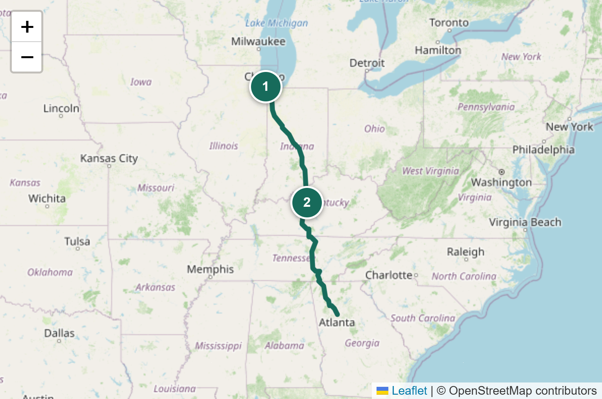
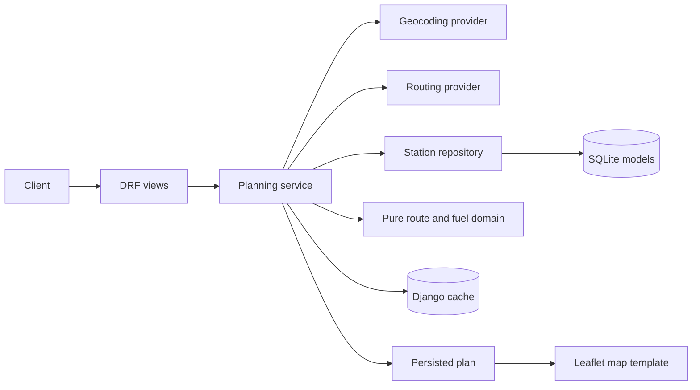
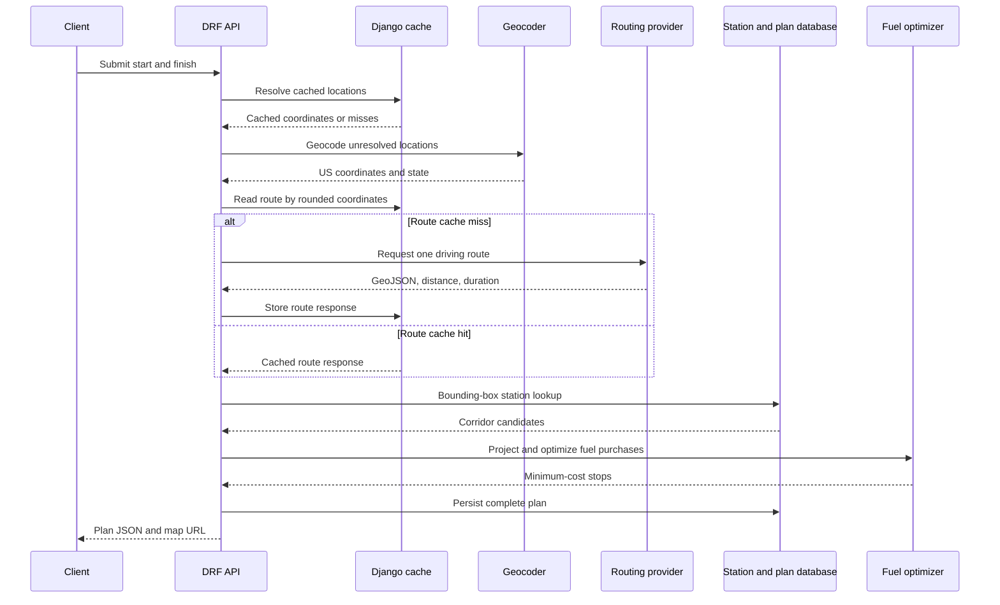

# Fuel Route Planner

A Django REST API that returns one driving route through the USA, the minimum-cost fuel purchases along that route, and a standalone Leaflet map. Requests accept place names or coordinates. Computed plans are stored and can be retrieved without recomputation.

## Demonstrated results

The following results were observed locally on November 19, 2026 using OSRM routing and Nominatim geocoding. They are demonstration snapshots, not live fuel prices or a guarantee of results on a fresh database.

| Metric | Chicago, IL to Atlanta, GA |
| --- | --- |
| Driving distance | 683.73 miles |
| Fuel stops | 2 |
| Fuel purchased | 18.5 gallons |
| Fuel purchase cost | $66.64 |
| Routing requests made | 1 |
| Reported compute time | 2,464.45 ms |



Map data: [OpenStreetMap contributors](https://www.openstreetmap.org/copyright). Rendered with Leaflet. Numbered markers indicate selected fuel stops, not the start and finish.

The timing is one uncached local request, not a benchmark, and excludes browser map loading. The vehicle starts with a full 50-gallon tank; the displayed cost excludes that initial fuel. Optimization uses the available geocoded stations along the selected route and excludes station detours.

After setup and station preparation, request `/api/v1/fuel-plans/?start=Chicago,IL&finish=Atlanta,GA`, then open the returned `map_url` on the same server. Plan IDs belong to the database that created them; saved local demo URLs do not transfer to a fresh clone.

### Findings and verification

- Dallas to Austin was about 195 miles and needed no fuel purchases with the default full starting tank.
- Station-coordinate coverage is essential: the Chicago to Denver attempt failed because the first available station was beyond the 500-mile range. This is a data-coverage limitation, not evidence that the actual road has no stations.
- Cold requests need at most two location lookups plus one driving-route request. Saved-plan retrieval makes no routing or geocoding requests; browser map tiles are separate requests.
- Before publication, all 40 tests passed locally on Windows with Python 3.12.10, with 93.25% domain/service coverage. Ruff and Django system checks passed. These local results do not confirm a Linux CI run.

## Architecture



### Request lifecycle



## Algorithm

The route polyline is measured cumulatively with haversine segment lengths. Candidate stations are first narrowed by an indexed SQL latitude/longitude bounding box, then projected onto route segments in vectorized NumPy and retained only within the configured corridor. Their closest projected point becomes the station mile marker.

Fuel purchases use 0.5-gallon increments. The pure domain solver tracks cumulative purchase ticks by station and derives remaining fuel from exact cumulative mileage, so arbitrary leg lengths do not accumulate rounding errors. Tank capacity is `range_miles / mpg`. DP states retain the least-cost history for each feasible purchase level; a prefix minimum combines earlier reachable station states. For N ordered stations, L feasible fuel states (about 101 for a 50-gallon tank), and W reachable predecessor stations, the DP is roughly O(N x W x L), with route projection vectorized. The brute-force test enumerates stop subsets and compares costs on small generated instances.

The greedy cheapest-next-stop heuristic can be close, but it optimizes only the next purchase decision. It can leave the vehicle poorly positioned for later prices and has no guarantee of minimizing total trip cost. The exact DP preserves a global minimum for the configured half-gallon purchase increment.

## Assumptions

- The default vehicle starts with a full 50-gallon tank: `START_FULL_TANK=true`. Set false to model an empty start; an origin station is then required to buy fuel before driving.
- Fuel economy defaults to 10 mpg; maximum range defaults to 500 miles. Both are environment-configurable.
- Stations are eligible within a 5-mile route corridor by default. Corridor proximity is not a modeled detour, and no detour fuel/time cost is added.
- Fuel is priced at the source retail price in USD per gallon. Only 0.5-gallon purchase increments are considered.
- Interstate/exit station addresses that fail geocoding use the city/state locality as an approximate fallback.
- Start and finish must resolve to one of the 50 states or DC. Territories and non-US locations are rejected.

## Data quality and ingestion

The supplied assessment describes an 8,151-row CSV. In the file added to this workspace, 678 OPIS IDs repeat, accounting for 1,413 extra rows before filtering; the assessment note calls 1,413 a repeated-ID count, but it is the duplicate-row count in this file. After US-state filtering, 568 IDs repeat and 905 extra rows collapse, leaving 6,626 unique US stations. The loader checks `data/fuel-prices-for-be-assessment.csv` first, then the workspace root (or an explicit `--file`), and reports observed counts when run. This file had 620 non-US/invalid-state rows and no non-positive or NaN prices.

- Canadian state/province codes `AB`, `BC`, `MB`, `NB`, `NS`, `ON`, `QC`, `SK`, and `YT` are dropped. Any other state not in the 50-state/DC allowlist is also excluded.
- Rows are keyed by OPIS Truckstop ID; duplicate rows collapse to one record with the lowest valid retail price. The command logs the number of collapsed repeated rows.
- Prices that are nonnumeric, NaN, infinite, zero, or negative are discarded.
- CSV records contain no coordinates. `geocode_stations` runs separately, attempts the full address, then `City, State`, and stores `address`, `city`, or `failed` quality. Every query result, including failures, is persisted for resumability; transient provider errors are retried on later runs.
- Choose `GEOCODING_PROVIDER=ors` with `ORS_API_KEY`, or `GEOCODING_PROVIDER=nominatim` with a descriptive `NOMINATIM_USER_AGENT`. Nominatim requests are spaced at least one second apart. Do not use its public service for bulk production geocoding without reviewing its usage policy.
- The station command stops immediately on HTTP 401, 403, or 429 so invalid credentials or exhausted quotas do not trigger requests for every remaining station. Fix the provider configuration/quota, then rerun the resumable command.
- `load_stations` uses an upsert keyed by OPIS ID and is safe to rerun. Loading a new price file updates source fields while preserving already geocoded coordinates.

## Tradeoffs

- **Exact DP vs greedy:** DP costs more CPU but gives a global optimum for the 0.5-gallon purchase model. Greedy is simpler and often close, but can miss a cheaper whole-trip plan.
- **OpenRouteService vs OSRM vs Google:** ORS is the default because one keyed request provides route distance, duration, and GeoJSON; its geocoder is also selectable. OSRM's public demo is a no-key routing fallback without an SLA, but it does not geocode place names. Google Directions can offer strong coverage and traffic data but requires a billing-enabled key and has different terms/costs; it is not implemented here.
- **SQLite vs PostGIS:** SQLite keeps assignment setup simple. PostGIS offers spatial indexes and efficient distance/corridor queries at scale, and is the production migration path.
- **Database vs in-memory station search:** Stations remain in the database; an indexed bounding box limits rows before NumPy projection. Loading all 6,000+ stations into Python per request would waste memory and request time. A spatial DB can improve selectivity further.
- **City centroid vs exact station geocoding:** City fallback is resilient and inexpensive but less accurate and may admit a station at the edge of the corridor incorrectly. Exact geocoding costs more calls and still depends on source address quality.
- **Corridor width vs detours:** Wider corridors find more options but can select stations farther from the driving path. The current objective deliberately ignores detour distance/cost; production routing should model station detours explicitly.
- **Cache and price staleness:** Django LocMemCache is the development default; set `CACHE_URL` for Redis. Route and request geocode keys use rounded coordinates and a configurable TTL; cached station prices do not expire independently because they are refreshed by reloading the input data. Plans retain their computed snapshot.
- **DRF vs plain Django views:** DRF supplies consistent input validation, JSON responses, and OpenAPI integration at the cost of another dependency and framework layer.

## Setup

Requires Python 3.12+. Django is pinned to 6.1.3, the latest stable release reported by djangoproject.com at implementation time.

```powershell
python -m venv .venv
.\.venv\Scripts\Activate.ps1
python -m pip install -r requirements-dev.txt
Copy-Item .env.example .env
```

Edit `.env` to set a secret key and choose a working geocoder. For OpenRouteService, set `GEOCODING_PROVIDER=ors` and provide `ORS_API_KEY`; for Nominatim, set `GEOCODING_PROVIDER=nominatim` and a descriptive contact-bearing `NOMINATIM_USER_AGENT`. For no-key demo routing, set `ROUTING_PROVIDER=osrm`; place-name geocoding still needs one of the configured geocoders. Never paste an API key into chat or commit `.env`. Then:

```powershell
python manage.py migrate
python manage.py load_stations
python manage.py geocode_stations --limit 5
python manage.py runserver
```

Geocoding is optional for startup and can make up to two provider requests per station (full address, then city fallback). Keep `--limit` small for a demo; do not run the command without a limit unless you intend to geocode every remaining station. Use `python manage.py load_stations --file path\to\fuel.csv` to choose another CSV. The project includes `Dockerfile`, `docker-compose.yml`, a Makefile, and a GitHub Actions workflow.

## API

- `POST /api/v1/fuel-plans/` with `{"start":"Dallas, TX","finish":"Denver, CO"}` or coordinate objects such as `{"start":{"lat":32.7767,"lon":-96.7970},"finish":{"lat":39.7392,"lon":-104.9903}}`.
- `GET /api/v1/fuel-plans/?start=Dallas%2C%20TX&finish=Denver%2C%20CO` for browser/Postman testing.
- `GET /api/v1/fuel-plans/{id}/` retrieves a stored result.
- `GET /api/v1/fuel-plans/{id}/map/` renders the standalone Leaflet map. `GET /api/v1/fuel-plans/map/?start=...&finish=...` also computes and renders a map.
- `GET /api/docs/` serves Swagger UI; `GET /api/schema/` serves the OpenAPI schema.

Successful output contains resolved US locations, route GeoJSON/distance/duration, ordered stops with gallons and cost, assumptions, a map URL, and cache/call/timing metadata. Errors use `{"error":{"code":"...","message":"...","details":{}}}`. An impossible fuel leg returns HTTP 422 with mile markers; invalid or non-US locations return 400; unresolved upstream route/geocoding returns 502.

JSON responses include at most four evenly spaced route coordinate pairs, including the endpoints, as a compact preview rather than navigation geometry. Fuel calculations and saved maps retain the complete route; open `map_url` to see the accurate driving path. Existing saved plans also return the compact preview when retrieved.

Example:

```powershell
curl.exe -X POST http://127.0.0.1:8000/api/v1/fuel-plans/ `
  -H "Content-Type: application/json" `
  -d '{"start":"Dallas, TX","finish":"Denver, CO"}'
```

Import `docs/postman_collection.json` into Postman. The create request stores its plan ID for the retrieval and map examples.

## Tests and lint

```powershell
python -m pytest --cov
ruff check .
python manage.py check
```

Tests mock routing and geocoding; they never make network requests. Domain/service coverage is configured to require 85%.

## Limitations and production next steps

The assessment CSV is excluded from version control and Docker images because permission to redistribute it publicly has not been established. Obtain it separately and place it in the workspace root or pass its path to `load_stations --file`. The local station database and saved plans are also excluded; a fresh clone must load and geocode its own station data. Station coverage determines which long trips can produce a feasible plan.

ORS requires a user API key; the selectable public OSRM endpoint may rate-limit or change. Request geocoding uses the configured ORS or Nominatim provider. Further production work should move spatial lookup to PostGIS, use Redis, geocode asynchronously in a managed job, schedule fuel-price refreshes, model actual station detours, add authentication and rate limiting, and deploy behind a production ASGI/WSGI server rather than Django's development server.

## Public repository safety

- Keep real credentials in the ignored `.env` file; commit only `.env.example` with placeholders. Never paste secrets into issues, screenshots, recordings, or CI logs.
- Git and Docker exclusions protect local environment files, databases, private key files, and generated caches. Review the staged diff before every commit.
- If a credential was ever published, revoke or rotate it immediately. Deleting it from the latest commit does not remove it from Git history.
- Enable GitHub secret scanning and push protection where available. Publishing source code does not deploy the running API.